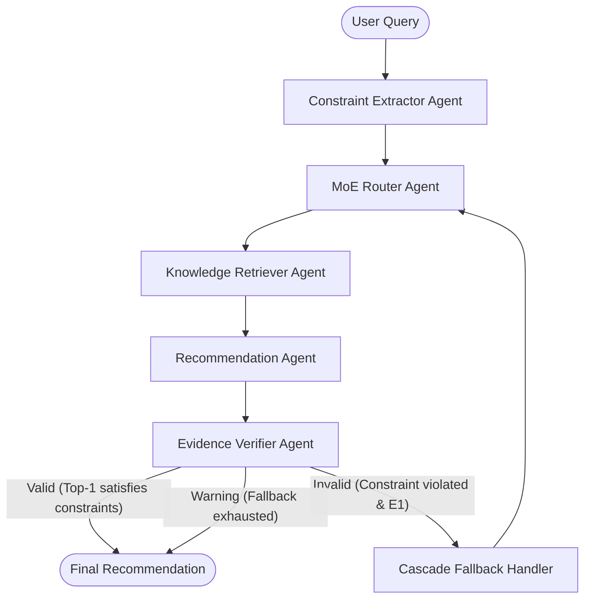

# Constraint-Aware MixRAGRec for Laptop Recommendation

> Master's course project — Multi-Agent RAG for Product Recommendation

## Research Question

Can extracting explicit user constraints (hard vs. soft) determine how much
product knowledge to retrieve, achieving better constraint satisfaction at
lower cost?

## Based On

**MixRAGRec** — *Mixture-of-Experts Knowledge Graph Retrieval-Augmented
Generation for Multi-Agent LLM-based Recommendation* (KDD 2026)  
Original repo: [github.com/Sjay-Wang/MixRAGRec](https://github.com/Sjay-Wang/MixRAGRec)

## Key Idea

Instead of always retrieving full product specs (expensive) or nothing (cheap
but inaccurate), a **router** selects the cheapest retrieval level that
satisfies the query:

| Expert | What the LLM sees | Avg tokens |
|--------|-------------------|------------|
| **E1** | Title only | ~1,300 |
| **E2** | Title + query-relevant specs | ~1,800 |
| **E3** | Title + full spec card | ~2,450 |

## Final Benchmark Results (198 Test Queries)

| Model / Baseline | Top-1 Accuracy | Avg Prompt Tokens | Token Savings vs E3 | E1 Routing Rate |
| :--- | :---: | :---: | :---: | :---: |
| **Fixed E1** (Title Only) | 85.4% | 1,283 | +47.1% | 100.0% |
| **Fixed E2** (Targeted Specs) | 99.5% | 1,776 | +26.8% | 0.0% |
| **Fixed E3** (Standard Full RAG) | 100.0% | 2,424 | 0.0% (ref) | 0.0% |
| **Random Router** (50/50) | 92.4% | 1,529 | +36.9% | 50.0% |
| **Trained Router** (Ours - Single-turn) | **98.0%** | **1,597** | **+34.1%** | 35.9% |
| **Cascade + Verifier** (Ours - Guardrail) | **99.5%** | **1,544** | **+36.3%** | 85.4% |
| **Oracle Router** (Theoretical Ceiling) | 100.0% | 1,357 | +44.0% | 85.4% |

**Key Takeaways:**
1. **Fixed E3 (Standard RAG)** is highly redundant, wasting ~1,140 extra ranker tokens per query compared to E1.
2. **Trained Router** achieves **98.0% accuracy** while saving **34.1% of ranker prompt tokens** in a single round of generation.
3. **Cascade + Verifier** achieves **99.5% accuracy** with **36.3% ranker token savings** (and **+17.8%** end-to-end including Extractor overhead), providing deterministic verification against extracted constraints.

## Extended Evaluation (v2/v3: Extractor Cost, 95% CIs & Filter Baselines)

Accounting for the ~450-token Extractor call (`EXT_TOKENS = 450`), total LLM calls (latency proxy), Wilson 95% confidence intervals, and deterministic pre-filter baselines on the 198 test queries:

| Method | Top-1 Acc | 95% CI (Wilson) | Total Tokens (+Ext) | Net Saving vs E3 | Avg LLM Calls |
| :--- | :---: | :---: | :---: | :---: | :---: |
| **Fixed E1** (Title Only) | 85.4% | [79.8%, 89.6%] | 1,283 | +47.1% | 1.00 |
| **Fixed E2** (Targeted Specs) | 99.5% | [97.2%, 99.9%] | 2,226 | +8.2% | 2.00 |
| **Fixed E3** (Standard Full RAG) | 100.0% | [98.1%, 100.0%] | 2,424 | +0.0% | 1.00 |
| **Trained Router** (Predictive) | 98.0% | [94.9%, 99.2%] | 2,047 | +15.6% | 2.00 |
| **Cascade + REAL Verifier** | 99.5% | [97.2%, 99.9%] | 1,994 | +17.8% | 2.15 |
| **Filter → LLM Rerank** (Survivors Only) | 100.0% | [98.1%, 100.0%] | 1,010 | +58.4% | 2.00 |
| **Filter Only** (Extracted, No Rerank) | 100.0% | [98.1%, 100.0%] | 450 | +81.4% | 1.00 |

- **Real Verifier Audit (`evaluate_v3.py`):** `TP=169, FP=0, FN=0, TN=29` on E1 top-1 (`0 / 198` extractor mismatches on template test queries), confirming zero false-accepts relative to ground truth on the test set.
- **Paired Bootstrap (10,000 resamples):** Accuracy difference between `Cascade + REAL Verifier` (99.5%) and `Fixed E3` (100.0%) is **not statistically significant** (`-0.5%`, 95% CI `[-1.5%, +0.0%]`).
- **Why keep LLM Ranking vs. Filter-Only?** Deterministic filtering works when all constraints exist in clean structured columns and only hard constraints are scored (`Filter → LLM Rerank` preserves soft-preference ranking at `1,010` tokens). Adaptive granularity routing (`Cascade` / `Trained Router`) targets settings where pre-filtering is unavailable (unstructured specs/reviews or black-box retrieval indices).

## Pilot Results (100 train queries)

| Method | Top-1 Accuracy | Avg Prompt Tokens |
|--------|---------------|-------------------|
| E1 (title only) | 79% | 1,307 |
| E2 (relevant specs) | 100% | 1,789 |
| E3 (full specs) | 100% | 2,451 |
| Oracle Router | 100% | 1,403 |

The oracle router picks E1 for 79% of queries and E2 for the remaining 21%,
achieving **100% accuracy at 43% fewer tokens** than E3.

## Architecture

```
User Query
    │
    ▼
┌──────────────────┐
│ Constraint        │  LLM extracts hard constraints
│ Extractor         │  (price, RAM, storage, brand)
│ (extractor.py)    │  and soft preferences
└────────┬─────────┘
         │
         ▼
┌──────────────────┐
│ Router            │  Selects cheapest expert
│ (train_router.py) │  likely to succeed
└────────┬─────────┘
         │
         ▼
┌──────────────────┐
│ Expert E1/E2/E3   │  Renders candidate info
│ (experts.py)      │  at selected granularity
└────────┬─────────┘
         │
         ▼
┌──────────────────┐
│ LLM Ranker        │  Ranks top-5 from 20
│ (pilot.py)        │  candidates
└────────┬─────────┘
         │
         ▼
┌──────────────────┐
│ Hard Constraint    │  Deterministic check:
│ Verifier           │  does top-1 satisfy
│ (deterministic)    │  all hard constraints?
└──────────────────┘
```

## Dataset

- **Source:** Amazon Reviews 2023 (McAuley Lab), Electronics → Laptops
- **Items:** 1,042 cleaned laptops with price, RAM, storage, weight, screen, brand
- **Queries:** 600 synthetic queries with ground-truth constraints
  - Pool: 20 candidates each (5 valid, 10 near-miss, 5 far)
  - Random baseline: ~25% top-1
- **Paraphrases:** 145 rewritten queries in 6 styles (chatty, keyword, formal, etc.)
- **Split:** train=303, dev=99, test=198 (grouped by constraint set, seed=42)

## Project Structure

```
code/
├── .env                  # API keys (not committed)
├── .gitignore
├── README.md             # This file
│
├── data/
│   ├── laptops_clean.parquet    # 1,042 cleaned laptops
│   ├── cards.json               # Structured spec cards
│   ├── queries.jsonl            # 600 queries with ground truth
│   ├── queries_para.jsonl       # 150 paraphrased queries
│   ├── queries_para_clean.jsonl # 145 validated paraphrases
│   ├── split.json               # train/dev/test split (DO NOT regenerate)
│   └── pilot_results.json       # Pilot: 100 train × 3 experts
│
├── check_data.py         # Data exploration & cleaning → laptops_clean.parquet
├── build_cards.py        # Build spec cards → cards.json
├── make_split.py         # Create train/dev/test split → split.json
├── paraphrase.py         # LLM paraphrasing → queries_para.jsonl
├── clean_para.py         # Filter bad paraphrases → queries_para_clean.jsonl
│
├── extractor.py          # Constraint Extractor (LLM + Pydantic + cache)
├── eval_extractor.py     # Evaluate extractor on template queries
├── eval_para.py          # Evaluate extractor on paraphrased queries
│
├── experts.py            # E1/E2/E3 rendering logic
├── pilot.py              # Run single expert on queries
├── run_all.py            # Run all experts, compute oracle router stats
├── test.py               # API provider speed test
│
├── collect.py            # Collect all results → router_data.jsonl
├── collect_top1.py       # Collect ranked item IDs for real Verifier → top1_data.jsonl
├── train_router.py       # Train & calibrate router policy → router_model.joblib
├── evaluate.py           # Benchmark evaluation across 7 baselines
├── evaluate_v2.py        # Extended evaluation: Wilson CIs, bootstrap, extractor cost, filter baseline
├── filter_rerank.py      # Deterministic filter → LLM rerank survivors baseline
├── evaluate_v3.py        # Real Verifier confusion matrix & filter-rerank comparison
├── agent_pipeline.py     # Stateful Multi-Agent LangGraph workflow & demo
├── api.py                # FastAPI + SSE backend for 3D Studio
└── static/
    └── index.html        # Bilingual 3D WebGL + Chart.js + SSE Live Studio
```

## Setup

```bash
python -m venv .venv
.venv\Scripts\activate        # Windows
pip install -r requirements.txt
```

Create `.env`:
```
NANOGPT_API_KEY=sk-nano-...
NANOGPT_PROVIDER=coralbricks-standard
```

## LLM

- **Model:** `deepseek/deepseek-v4.1-flash-1017`
- **API:** NanoGPT (OpenAI-compatible, `https://nano-gpt.com/api/v1`)
- **Provider:** `coralbricks-standard` via `X-Provider` header

## Simplifications vs. Original Paper

| Aspect | MixRAGRec (original) | This project |
|--------|---------------------|--------------|
| Knowledge structure | Knowledge Graph (triples, subgraphs) | Tabular spec cards |
| LLM | LLaMA-3-8B / Mistral-7B (local) | DeepSeek V4.1 Flash (API) |
| Router training | PPO/GAE with MMAPO reward | Cost-Sensitive Calibrated Router |
| Contrastive learning | DPO-style fine-tuning | Not implemented |
| Alignment agent | LLM rewriting | Deterministic formatting |
| Candidate pool | 1 target + 19 distractors | 5 valid + 10 near-miss + 5 far |
| Queries | From user history | Synthetic with ground truth |
| Hardware | 96 GB GPU | RTX 3060 6GB + API |

## Status

- [x] Data collection & cleaning
- [x] Query generation (600 template + 145 paraphrased)
- [x] Constraint Extractor (97% accuracy)
- [x] Three expert levels (E1/E2/E3)
- [x] Pilot experiment (100 train queries)
- [x] Full data collection (all splits x all experts)
- [x] Router training & tuning
- [x] Cascade baseline
- [x] Full evaluation & comparison
- [x] Multi-Agent LangGraph Pipeline (Demo & Trace)
- [ ] Final report

## Multi-Agent LangGraph Architecture

The system is fully orchestrated using **LangGraph** (`agent_pipeline.py`) as a stateful, cooperative multi-agent workflow:



Run interactive CLI demo:
```bash
python agent_pipeline.py
```

Run 3D & Real-Time SSE Web Studio:
```bash
python -m uvicorn api:app --reload --port 8000
```
Then open `http://localhost:8000` in your browser.

## Limitations

- **Structured Catalog Assumption:** The Verifier and pre-filter baselines assume access to clean tabular attributes (`cards.json`). In this structured setting, `Filter → LLM Rerank` achieves 100.0% accuracy at lower token cost (`1,010` vs `1,994`).
- **Verification Scope:** Guarantees hold **relative to extracted constraints** (0% mismatch on template test queries, 97% full-match on paraphrased queries in `eval_para.py`).
- **Evaluation Scope:** Uses 20-candidate pools with 5 valid items per query (infeasible queries are demonstrated in the UI/API, not the 198-item test benchmark), soft preferences are not quantitatively scored, and results reflect a single LLM (`deepseek/deepseek-v4.1-flash-1017`) and split seed (`42`).

## License

Course project — not for redistribution.
